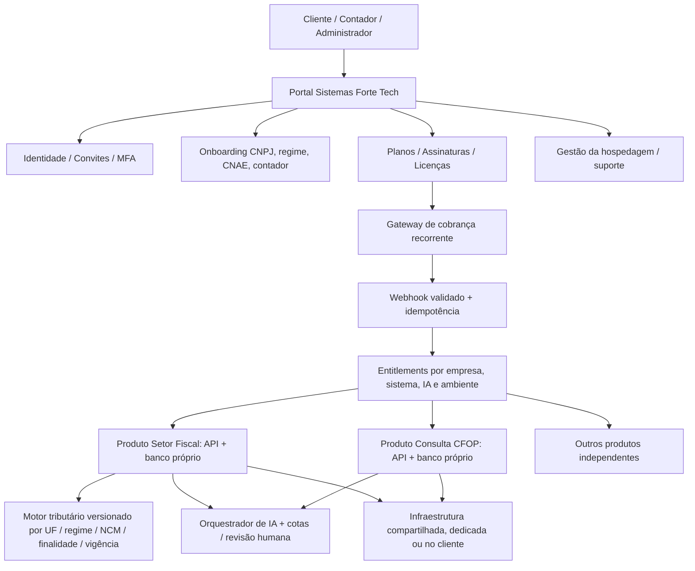

# Sistemas Forte Tech — Arquitetura SaaS, licenciamento, IA, hospedagem e cobrança
**Versão proposta:** 2026-11-12  
**Status:** especificação de arquitetura; não representa implantação concluída.  
**Escopo:** Setor Fiscal Multiempresa e outros produtos **independentes** Sistemas Forte Tech. Não alterar FORTE FISCAL, FORTE OPERACIONAL, MC-6 nem Consulta CFOP sem execução explicitamente autorizada e homologação de integração.

## 1. Objetivo e decisões centrais
- Oferecer software para **qualquer empresa apta a ser atendida**: onboarding inicial genérico para 27 UFs, mas fiscal/contábil operacional somente quando regime, UF, operação e documento estiverem homologados.
- **Uma licença por (sistema, empresa).** Matriz e filiais dentro da mesma pessoa jurídica compartilham licença-base empresarial, com preço adicional por unidade se previsto no plano. Grupos com CNPJs-raiz distintos não compartilham licenças.
- IA contratada como **plano/limite de consumo independente**, associado à empresa e às finalidades permitidas. O usuário não precisa contratar uma assinatura ChatGPT pessoal; a plataforma poderá comprar API de IA e revender uso conforme contrato, ou permitir chave própria em modalidade empresarial futura.
- **Nuvem compartilhada como padrão**, incluindo hospedagem do serviço no plano. Nuvem dedicada e instalação em servidor físico/nuvem do próprio cliente como modalidades enterprise com contrato e suporte específicos.
- Uma empresa pode fazer cadastro e pagar antes de estar fiscalmente pronta, mas deve ver situação `AGUARDANDO_HOMOLOGACAO` e não poder emitir documentos até completar as etapas de legalidade e testes.

## 2. Visão estrutural


**Control plane**: identidade, contratos, assinatura, licença, cota de IA, faturamento, provisionamento, auditoria comercial e estado de saúde; sem copiar informações fiscais entre produtos.  
**Data plane**: cada produto preserva seu repositório, API, regras e banco de dados; cada chamada autenticada exige autorização de `company_id`, sistema e recurso. Integração entre sistemas **somente por API/eventos com escopo**. Uma licença em outro banco não pode ser simulada pelo navegador.

## 3. Jornada de cadastro e ativação (máquina de estados)
```
CADASTRO_INICIADO
 -> CNPJ_VALIDADO (numérico ou alfanumérico; atividade, situação cadastral e matriz/filial)
 -> REGIME_CONFERIDO (Simples/SIMEI em fonte oficial; demais confirmado pelo contador)
 -> CONTADOR_CONVIDADO (e-mail confirmado, CRC/UF informado)
 -> CONTADOR_APROVADO (identidade, vínculo, CRC e procuração quando aplicável)
 -> PRODUTOS_CLASSIFICADOS (IA sugere; contador revisa; NCM/CEST/NBS/CFOP e evidência)
 -> PLANO_SISTEMA_ESCOLHIDO + PLANO_IA_ESCOLHIDO + AMBIENTE_ESCOLHIDO
 -> COBRANCA_CONFIRMADA (evento de provedor verificado pelo backend)
 -> LICENCA_ATIVA (habilita funções administrativas contratadas)
 -> HOMOLOGACAO_FISCAL_CONCLUIDA (habilita apenas operações fiscais testadas)
```
**Não presumir regime tributário baseado somente em CNAE ou cadastro básico do CNPJ.** Regime tributário, atividade efetivamente exercida, finalidade, origem/destino, destinatário e legislação válida precisam de fontes e revisão. CNPJ alfanumérico é utilizado desde julho de 2026.

Condições mínimas para recursos operacionais:
```
allowed = identidade_autenticada
  && membro_autorizado_no_CNPJ
  && licenca_do_sistema_ativa_no_servidor
  && empresa_regularizada_no_fluxo_de_onboarding
  && plano_de_IA_ativo_se_recurso_usa_IA
  && quota_IA_disponivel_se_recurso_usa_IA
  && operacao_homologada_se_gera_efeito_fiscal
  && infraestrutura_adequada_para_o_recurso
```
Falha de qualquer requisito = negar a operação, exibir motivo e opções de regularização, sem apagar dados.

## 4. Contador responsável
- Um profissional identificado pode atuar em vários CNPJs, com escopos e autorizações **separados por empresa**.
- Verificar dados profissionais, CRC/UF, registro quando viável e procuração específica para serviços oficiais. **CRC digitado não é verificação de registro.**
- Controle de delegações por empresa: ADMIN, CONTADOR, OPERADOR, CONSULTA, Master comercial. Vinculação inicial por convite aceito no e-mail confirmado.
- Limitar acesso aos campos necessários. Registro do contador não equivale a poder de transmitir ECD/ECF/eSocial/DCTFWeb.
- Considerar se determinadas categorias empresariais não exigem legalmente contador; a exigência de responsável é uma **política de contratação da plataforma**, não uma afirmação legal universal.

## 5. Catálogo fiscal + IA assistida
- Produto/serviço: SKU, GTIN quando existir, NCM, CEST, NBS/serviço, descrição, unidade, origem, finalidade, regime, ICMS-ST, UF origem/destino, vigência e evidência.
- IA só sugere classificações, inconformidades, possíveis códigos e documentação. Não cria ou homologa automaticamente regra legal, não transmite nota e não aprova movimentação financeira.
- Para cada sugestão: modelo e versão, custo/consumo, data, referência de lei e vigência, grau de confiança, parecer/revisão do contador, trilha de auditoria.
- Uma mudança de lei gera **versão de regra**, testes de regressão e aprovação antes de uso; comportamentos divergentes exigem revisão humana.
- Dados privados à IA: padrão sem envio; ativação somente com contrato, base legal, minimização/mascaramento e consentimentos pertinentes.

## 6. Produtos, planos e receita recorrente
Sugestão de catálogo inicial (preços **a definir**, não publicados/comercializados):
```
product: SFT_CONSULTA_CFOP | SFT_SETOR_FISCAL | novos produtos
plan: BASICO | PROFISSIONAL | EMPRESARIAL
addon: IA_ESSENCIAL | IA_AVANCADA
hosting: SHARED_CLOUD | DEDICATED_CLOUD | CUSTOMER_HOSTED
billing_period: MONTHLY | ANNUAL
```
Modelo:
**Mensalidade = soma de licenças dos sistemas + plano de IA + opcionais contratados (usuários/filiais/integrações/SLA) + hospedagem dedicada/administrada**.  
Nuvem compartilhada inclusa no plano-base evita que cada pequeno cliente precise comprar um servidor. Implantação, migração, treinamento, integração e auditoria técnica podem ser cobrados separadamente.

Preço deve considerar: API de IA, hospedagem, dados/banco e storage, backup e restauração, segurança, mensagens e e-mail, gateway, tributos, equipe de suporte e reserva para incidentes. Travar cota de IA/custo por empresa para evitar prejuízo por consumo inesperado.

### Cobrança mensal brasileira
**Proposta de gateway para avaliar primeiro:** Asaas, por documentar API de assinatura, boleto, Pix, cartão, Pix Automático (quando elegível) e webhooks. Não assumir elegibilidade, contrato, taxas ou condições antes de abrir conta.
1. Empresa escolhe plano e confirma termos; servidor cria `billing_customer`, contrato e assinatura no gateway **em sandbox**.
2. Provedor gera cobrança; frontend mostra status **AGUARDANDO_PAGAMENTO**, sem liberar licença por clique no navegador.
3. Webhook autenticado e verificado pelo servidor; evento com ID único / idempotência e confirmação de status via API do provedor quando apropriado.
4. Banco local registra fatura, evento, crédito e período contratado; **serviço central** modifica o direito de uso.
5. Todo mês: nova cobrança do ciclo; pagamento validado renova; falha gera aviso e política contratual de tolerância.
6. Fase de inadimplência: lembretes, período de tolerância documentado, acesso somente leitura/exportação durante período contratual, e bloqueio de novas operações ao final; **não excluir dados por simples atraso**.
7. Cancelamento: política de reembolso/retorno de dados, histórico financeiro e notas fiscais de prestação de serviços emitidas pelo próprio fornecedor de SaaS quando aplicável.
8. Reconciliação periódica entre webhook, API do gateway e ledger interno; tratar notificações duplicadas, fora de ordem e chargebacks.

**Pix de cobrança mensal convencional não é débito automático**. Pix Automático requer autorização específica do pagador e elegibilidade da conta recebedora.

## 7. Infraestrutura e operação
| Modalidade | Banco e software | Responsável por atualizações/backups | Para quem |
|---|---|---|---|
| Nuvem compartilhada | Aplicação multiempresa com isolamento RLS/tenant e serviço gerenciado | Sistemas Forte Tech + provedores, conforme responsabilidade compartilhada | Pequenas/médias empresas; opção padrão |
| Nuvem dedicada | Deploy e banco dedicados para o cliente | Sistemas Forte Tech conforme SLA/contrato + provedor cloud | Clientes com isolamento adicional |
| Servidor físico/próprio do cliente | Distribuição privada, autenticação/licença sincronizada, backups e monitoramento contratuais | Definir por contrato; sem acesso remoto irrestrito | Empresas com requisitos específicos de infraestrutura |

Servidor próprio: prever contrato de instalação/manutenção, atualização assistida, backup e restore, DNS/SSL, conectividade e sincronização de licenças. Se funcionamento sem internet for necessário, licença assinada e validada localmente com expiração curta, limites de operação e sincronização posterior; **emissão fiscal depende dos serviços oficiais/regras de contingência**. Uma implantação própria não é isenta de custos: a empresa passa a operar toda a infraestrutura, salvo suporte explicitamente contratado.

### Operação do fornecedor SaaS
- Ambiente separado de desenvolvimento, homologação e produção; testes automáticos, migrações reversíveis e implantação controlada.
- Monitorar disponibilidade por sistema, latência, fila de integrações, taxas de erro, jobs, webhook, vencimentos, custos por cliente e cota de IA; alertas para incidentes.
- Backups automáticos com retenção definida e **testes reais de restauração**; cópias fora do ambiente principal, criptografia, política de incidentes, logs sem segredos.
- Segredos no servidor e rotação; certificados A1 em cofre com permissões por CNPJ; autenticação forte/MFA para Master e contador; audit trail.
- LGPD: definir papéis controlador/operador por tratamento, contratos com suboperadores, política de retenção, exportação, exclusão e atendimento aos titulares.
- Engenharia de suporte: painel de saúde, logs por empresa sem expor conteúdo de outros clientes, base de conhecimento, SLA e tickets.
- Processos regulares: diariamente alertas/filas/backups/cobranças; semanalmente atualização de dependências e testes; mensalmente custos/margens por cliente, restore, revisão de permissões e regras fiscais.

## 8. Modelo de dados do plano comercial (proposto)
- `organizations / companies / establishments`: grupo, pessoa jurídica, matriz/filial.
- `accountant_assignments`: CRC/UF, fonte/evidência de verificação, papel e vigência.
- `system_catalog / plans / plan_features / plan_prices`: produtos independentes, recursos e preços versionados.
- `subscriptions / subscription_items`: contrato mensal, múltiplos produtos, addons de IA e hospedagem.
- `invoices / payments / payment_events`: competência, cobrança, confirmação, reembolso, chargeback, trilha idempotente.
- `license_entitlements`: direito de usar determinado produto para determinado CNPJ, derivado de contrato e pagamento.
- `ai_plan_quota / ai_usage_ledger / ai_job_audit`: uso separado por empresa e produto, limites e custo por tarefa.
- `deployments / infrastructure_profiles`: hospedagem, ambiente, região, backup, SLA e versão.
- `support_tickets / audit_events / tax_rule_evidence`: manutenção e auditoria.

**A regra deve ficar no servidor:** nunca habilitar licença, IA ilimitada ou NF-e baseado somente em um indicador alterável pelo usuário ou numa tela frontend.

## 9. Estado atual e próximos incrementos
Estado conhecido do Setor Fiscal Multiempresa: já existem cadastro de CNPJ e filiais, controle de contador, produtos, estrutura de IA, integrações financeiras e catálogo de licenças por (empresa,sistema), porém **não há clientes operacionais, login Master testado ponta a ponta, faturamento recorrente, integração de pagamento ou emissão fiscal homologada**. Consulta CFOP é independente e **não consulta automaticamente** essas licenças.

**Fases recomendadas:**
1. Isolar repositório e serviço de **Control Plane** do portfólio; não misturar dados do FORTE OPERACIONAL. Criar autenticação e bootstrap comercial self-service de CNPJ sem dados operacionais antes de licença.
2. Ligar cadastro/validação de CNPJ/regime/CNAE e contador responsável; autorizações robustas e testes reais com dois CNPJs e dois contadores.
3. Criar catálogo de planos, assinatura, fatura e integração Asaas sandbox com webhook seguro e reconciliação; ativação/expiração comercial automática via eventos confirmados.
4. Implementar IA por consumo com limites, franquias e revisão humana; parametrização tributária versionada e homologada por cenário.
5. Implantar ambiente **cloud compartilhado** em produção com backups, monitoramento, política LGPD e suporte; depois expandir sistema a sistema.
6. Somente depois oferecer plano dedicado/on-prem com deploy automatizado, mecanismo de licença assinado e políticas de suporte específicas.

## 10. Critérios de aceite para comercializar
- [ ] Login Master e usuário final conferidos; MFA nos perfis privilegiados.
- [ ] CNPJ numérico e alfanumérico, filial, CNAE, opção Simples/MEI e regime fiscal revisados.
- [ ] Contador verifica e aceita convite; autorização por CNPJ funcionando.
- [ ] Sistema X não libera Y; cliente A não enxerga B; licença vencida bloqueia no servidor.
- [ ] Assinatura mensal em sandbox: pagamento/atraso/cancelamento/estorno e duplicidade de webhook testados.
- [ ] Cota de IA se esgota/renova corretamente; custos por cliente monitorados.
- [ ] Backup restaurado; deploy e rollback; alarmes e suporte.
- [ ] Termos de contrato, LGPD, cobrança/ISS e política de retenção aprovados.
- [ ] Emissão fiscal só habilitada para cenários autorizados e homologados (etapa separada).

## Fontes e verificações atuais
- Asaas: https://docs.asaas.com/docs/assinaturas ; https://docs.asaas.com/docs/pix-automatico
- Asaas Webhooks e idempotência: https://central.ajuda.asaas.com/hc/pt-br/articles/55668763565979-O-que-%C3%A9-e-como-funciona-o-Webhook-do-Asaas
- Supabase self-hosting e responsabilidades: https://supabase.com/docs/guides/self-hosting
- Receita Federal CNPJ alfanumérico: https://www.gov.br/receitafederal/pt-br/assuntos/noticias/2026/julho/receita-federal-gera-o-primeiro-cnpj-em-formato-alfanumerico
- ANPD segurança: https://www.gov.br/anpd/pt-br/centrais-de-conteudo/materiais-educativos-e-publicacoes/guia-orientativo-sobre-seguranca-da-informacao-para-agentes-de-tratamento-de-pequeno-porte
